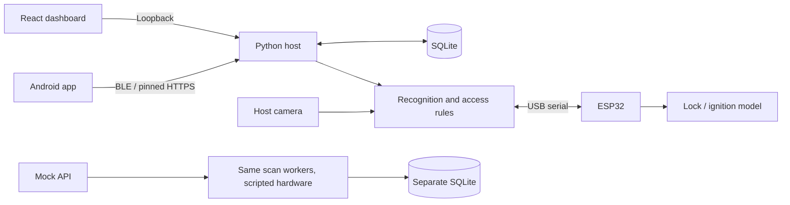

# Biometric Automobile Security System (B.A.S.S.)

CMPE 195B · [Grading commands](impl.yaml) ·
[Verification and submission status](docs/implementation-2-verification.md)

## Team

| Name | GitHub |
|---|---|
| Taanish Patel | [pateltaanish](https://github.com/pateltaanish) |
| Adam Mejia | [AdamMejia](https://github.com/AdamMejia) |
| Nick Thi | [nicholastee22](https://github.com/nicholastee22) |
| Greg Lu | [vvv017](https://github.com/vvv017) |

Advisor: Eric Vanuska.

Three team members commit from a shared Raspberry Pi through Taanish Patel's
GitHub account (`pateltaanish`). Those commits represent work by multiple members.

## Project Description

B.A.S.S. uses facial recognition to control access to a model vehicle.
A Python host connects a camera and local user database to a React dashboard,
Android BLE app, and ESP32 lock/ignition controller.

## Prototype Scope

Implemented: PIN and role management, host-camera enrollment and recognition,
Android BLE access, ESP32 serial control, and a standalone mock API.
PC mode simulates actuators; Pi mode sends serial commands to the bench controller.
The mock uses scripted faces and a separate disposable database.

Anti-spoofing, measured actuator position, CAN and vehicle-safety validation
remain incomplete. Liveness defaults to enabled and blocks face operations;
an administrator must disable it for prototype use. Controller acknowledgements
do not prove physical movement. Current hardware acceptance remains pending.

## System Architecture



The host owns identity, authorization, camera and data. Dashboard scans require
PIN authorization and the signed-in user's face. ESP32 presence-triggered scans
use the [request-ID protocol](ESP32_Program/ReadMe.md#serial-protocol).

## Prerequisites

| Path | Requirements |
|---|---|
| Mock / grader | Git, Node.js 22.12+, npm, Python 3.11 with pip/venv, Bash, curl 7.76+, internet |
| Firmware build | Arduino CLI 1.5.1; pinned core/libraries download on first build; several GB free |
| Android | JDK 17, SDK 36, build-tools 35.0.0; Android 8+ phone with BLE |
| PC host | Webcam, OpenSSL, full Python recognition dependencies |
| Pi host | Raspberry Pi 5, Raspberry Pi OS/Python 3.11, Picamera2, BlueZ, camera, ESP32 and [bench hardware](ESP32_Program/ReadMe.md#hardware) |

`impl.yaml` targets Linux x86_64 and uses `tar`/`sha256sum` to install Arduino CLI.
The mock needs no hardware, cloud account or private credentials.

## Installation

Run from the repository root. Use a separate Python environment for grading.

1. Clone:

   ```bash
   git clone https://github.com/SJSU-CMPE-195/group-project-team-face-id.git
   cd group-project-team-face-id
   ```

   For grading, check out `impl2-v1` after the team publishes it.

2. Create and activate the environment:

   ```bash
   python -m venv .venv-grader
   . .venv-grader/bin/activate
   ```

   PowerShell activation: `.\.venv-grader\Scripts\Activate.ps1`.

3. Install and build:

   ```bash
   npm ci
   python -m pip install -r requirements-http.txt numpy opencv-python-headless
   npm run build
   ```

   Firmware setup: [verified CLI download and build](ESP32_Program/ReadMe.md#build).
   Automation uses the same commands in `impl.yaml`.

Optional settings are listed in [.env.example](.env.example). Python and the
PowerShell launchers do not auto-load `.env`; export needed variables yourself.
Keep credentials, device identities and signing keys out of Git.

| Variables | Purpose |
|---|---|
| `BASS_RUNTIME_MODE`, `BASS_HOST`, `BASS_PORT`, `BASS_DASHBOARD_PORT` | Host mode and listeners |
| `FACEID_DB_PATH`, `BASS_DEVICE_CONFIG`, `BASS_STATE_DIR`, `BASS_DEVICE_NAME`, `BASS_OPENSSL` | Host storage, identity and TLS |
| `ESP32_SERIAL_PORT`, `ESP32_TRIGGER_ENABLED` | Serial connection and presence trigger |
| `PI_SCAN_TIMEOUT_SECONDS`, `PI_ENROLL_TIMEOUT_SECONDS`, `PI_ENROLL_SAMPLE_INTERVAL_SECONDS`, `PI_CAMERA_CLOSE_TIMEOUT_SECONDS` | Camera timing |
| `PORT` | Mock listener |
| `FACEID_SERVICE_USER`, `FACEID_DB_DIR`, `BASS_DEVICE_CONFIG_SOURCE` | Pi installation |
| `BASS_ANDROID_KEYSTORE`, `BASS_ANDROID_STORE_PASSWORD`, `BASS_ANDROID_KEY_ALIAS`, `BASS_ANDROID_KEY_PASSWORD` | Release signing; set all four or none |

For Pi, copy the built `dist/` into its checkout, then run:

```bash
bash scripts/install-wireless-pi.sh
```

The installer adds the full recognition stack and starts the service.
See [Pi setup](docs/android-wireless.md#pi-handoff). Keep the grader's headless
OpenCV environment separate from the real camera environment.

## Running the Prototype

### Without hardware

Start the mock:

```bash
python mock_pi_device_api.py
```

It binds to `127.0.0.1:5055` and stores `.cache/simulated_faceid.db`, separate
from the PC host. It has no login or dashboard; keep it on loopback.

In another Bash terminal (Git Bash on Windows):

```bash
curl --fail-with-body http://127.0.0.1:5055/health
curl --fail-with-body -X POST http://127.0.0.1:5055/api/settings \
  -H 'Content-Type: application/json' -d '{"liveness":false}'
curl --fail-with-body -X PUT http://127.0.0.1:5055/sim/scenario \
  -H 'Content-Type: application/json' \
  -d '{"frames":[{"identity":"Demo Driver","face_count":1,"score":0.91}]}'
curl --fail-with-body -X POST http://127.0.0.1:5055/api/scan/start \
  -H 'Content-Type: application/json' \
  -d '{"purpose":"unlock","expected_user":"Demo Driver"}'
```

Replace `SESSION_ID` with the returned ID and poll until the scan finishes:

```bash
curl --fail-with-body 'http://127.0.0.1:5055/api/scan/status?session_id=SESSION_ID'
curl --fail-with-body http://127.0.0.1:5055/sim/commands
```

Expected: `granted` and a simulated `UNLOCK`; the default timer relocks after
10 seconds. Unknown faces do not grant access. Ctrl+C stops the server.
The liveness override applies only to this fixture. It does not verify a real
face or exercise the normal dashboard/Android connection.

### Real host

Windows PC:

```powershell
.\scripts\start-wireless.ps1
```

Provisioned Pi:

```bash
sudo systemctl start faceid-wireless.service
```

Open `http://localhost:5057` on the host. Activate the first owner in Android
using its activation QR, then sign in to the dashboard. Disable liveness in
**Settings** for prototype use, then enroll a face in **Users**. In **Control**,
enter the account's PIN and start a face scan. Only one host process may own the
camera and ESP32.

Guides: [activation and pairing](docs/android-wireless.md#one-dashboard-and-phone-connection),
[Windows Bluetooth client](docs/pc-bluetooth.md),
[troubleshooting](docs/hardware-reference.md#troubleshooting).

## Testing

From the repository root with the grading environment active:

```bash
npm run lint
npm run build
python -m compileall -q db.py db_api.py safety_policy.py pi_device_api.py mock_pi_device_api.py bass_wireless.py wireless car_face_auth/src scripts
python -B -m unittest discover -s tests -v
.cache/arduino-cli/arduino-cli compile --profile impl2 ESP32_Program
```

These cover frontend/PWA checks, Python syntax, API/security/scan behavior and
native firmware compilation. Python firmware tests use a separate C++17 harness;
they skip if `g++`, `clang++` or `zig` is unavailable. The mock integration subset:

```bash
python -B -m unittest discover -s tests -p test_simulated_pi_api.py -v
```

Android: [build and lint instructions](docs/android-wireless.md#build-the-apk).
Actual results and checks not run: [verification record](docs/implementation-2-verification.md).

## Demo

**Video: pending public 3–5 minute URL.** Add it here and to `impl.yaml`.
[Build logs and verification](docs/implementation-2-verification.md) are available;
[earlier PoC screenshots](car_face_auth/images/) do not show the current system.

## Technical Stack

| Component | Stack |
|---|---|
| Dashboard | JavaScript, React, Vite, Tailwind CSS |
| Host | Python, Flask/Cheroot, pyOpenSSL, SQLite, InsightFace/ONNX, OpenCV/Picamera2 |
| Android | Kotlin, Jetpack Compose, CameraX, BLE/GATT |
| Controller | Arduino C++, ESP32, AccelStepper, LiquidCrystal |
| Deployment | Raspberry Pi OS, systemd, USB serial |

Details: [API and recovery](docs/android-wireless.md#api-and-recovery),
[firmware and wiring](ESP32_Program/ReadMe.md),
[hardware reference](docs/hardware-reference.md).

## What's Next

Before the December 11, 2026 Expo: implement anti-spoofing and physical feedback,
validate the Pi/phone/ESP32 journey and recovery, and finish Android release
signing. [CAN](docs/hardware-reference.md#can-bus-migration-planned-not-yet-implemented)
remains optional; its proposed RX pin conflicts with the LCD.

Before submission: add the video, publish the reviewed commit as `impl2-v1`,
and submit both links on Canvas. See [submission status](docs/implementation-2-verification.md#submission-status).
